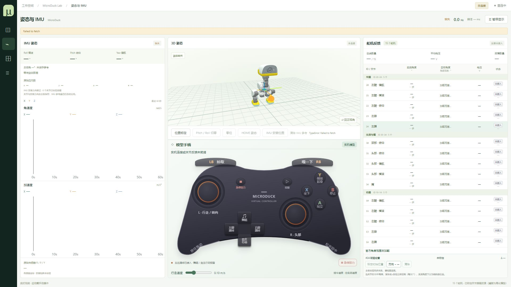
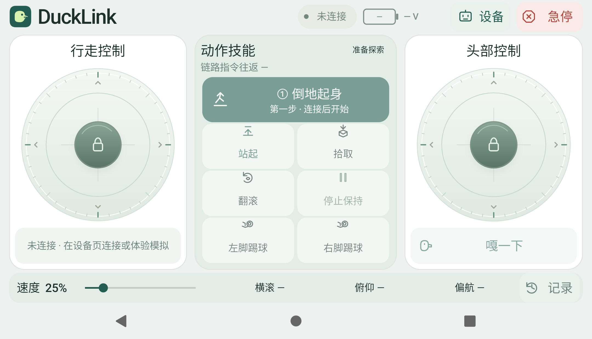
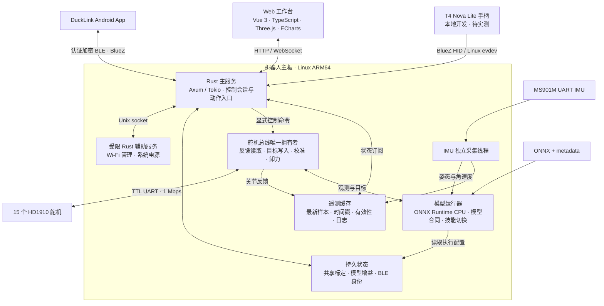

# MicroDuck Observer

**2026-10-25 本地更新：** 在合并后的主分支接入 HD1910 **30001 轮轮滑模型**。卸力后回中长按 **LB＋RB 1 秒**进入安装姿势，装轮后按 **A** 平衡，再用左摇杆前后滑行/转向。代码与 ARM64 离线部署包已完成，未部署实机。[模型路径](models/swizzle_hd1910.onnx) · [操作与测试结论](docs/swizzle-controller-20261025.md)。

**2026-10-22 更新：** 统一各动作返回行走的站姿判定，连续站稳0.5秒即交接；翻滚1.6秒后收腿、接倒地起身。已部署57鸭子（`runtime-20261022-151107`），用户实测反馈效果良好。模型权重保持，详见[切换规则与测试结论](docs/shared-walk-handoff-20261022.md)。

面向 MicroDuck 实机的观测、标定与控制平台。将网页调试、Android 蓝牙遥控、传感器采集、舵机执行和 ONNX 策略运行统一接入 Rust 控制后端，让界面显示的状态、模型使用的反馈和机器人执行的命令来自同一条控制链路。

本仓库维护机器人端服务、Web 工作台、模型运行合同及实测证据。Android App 在独立项目 [DuckLink](https://github.com/Ley-WL/ducklink) 中维护。

2026-10-21 更新：已接入并部署 HD1910 3000轮右脚金鸡独立模型，固定左支撑、右抬脚，保留现役5000轮行走模型。板端推理与服务校验通过，实物动作待用户测试。[模型说明](models/flamingo_right_hd1910.README.md) · [部署证据](docs/实测记录/附件/平台/2026-10-21/flamingo-right/deployment.json)。

2026-10-22 更新：233 已选用自训 HD1910 拾取 1001 轮模型；坐站改为 IMU 与腿部姿态/速度连续稳定 0.5 秒后切回行走，取消固定 6 秒等待。用户实测反馈通过。[拾取模型与训练](models/xgoduck_pick.README.md) · [坐站切换与测试](docs/sitstand-stable-handoff-20261022.md)。

## 手柄自定义控制

侧栏「手柄设置」支持8个动作键自定义、取消绑定及恢复默认，网页与板端实体手柄共用持久化配置；固定急停/停止及起身长按保留。当前为本地实现，未部署实机，见 [手柄映射说明](docs/gamepad-bindings.md)。

## 模型管理

侧栏独立「模型管理」页面支持显式模型选择、默认执行模板、完整metadata和部分官方manifest导入、上一版本回退，姿态工作台保持原布局。同合同的新权重无需重编后端；停止控制后校验与预热，导入不自动启用。当前为本地实现，尚未部署实机。操作、接口及验证方法见 [模型管理说明](docs/model-registry.md)。

## 功能规划

- [自主行动功能规划](docs/autonomous-action-plan.md)：2026-10-19确认，第一版模式切换、人工接管、6秒限时起身及后续感知路线；尚未实现。

## 硬件设计资料

硬件工程、BOM、加工文件、效果图与设计检查统一存放在 [hardware/](hardware/README.md)，后续硬件模块也从该目录继续。当前电源Hub为 [Rev N / ECO1无开关＋C1版本](hardware/power-hub/README.md)，内含立创EDA、KiCad源文件、Gerber及采购清单；源检查通过，立创客户端与实物验证状态见版本说明。实测主记录继续维护在 [docs/实测记录/](docs/实测记录/README.md)。

## 界面预览

### Observer 主控工作台

将 3D 姿态、IMU 曲线、网页虚拟手柄与 15 个舵机反馈放在同一工作台。中央保留 3D 视图和可读的手柄控制区；高度不足时控制区滚动，窄屏按列重排，手柄改用分区布局，避免文字和按钮被强行缩小。



截图来自 **2026-10-14 最新 Web 源码**本地页面，浏览器视口 **1920×1080 CSS px、100% 缩放、DPR 1**，图片也是1920×1080。处于未连接状态，3D 是参考模型，曲线和关节数值等待设备反馈，动作按钮禁用。另已检查 [1280×720](docs/validation/20261014-gamepad-layout/1280x720.jpg)、[1366×768](docs/validation/20261014-gamepad-layout/1366x768.jpg) 和 [390px 窄屏](docs/validation/20261014-gamepad-layout/390x844.jpg)；窄屏截图为完整滚动页面。

网页手柄支持鼠标和多指触控：左摇杆行走 / 转向、右摇杆控制头部，松开归零。当前按键如下：

| 按键 | 网页功能 |
| --- | --- |
| A / X / Y | 站立 / 坐下 / 倒地起身 |
| B | 停止保持 |
| Back | 急停卸力；手柄外另保留独立急停按钮 |
| LB / RB | 一键演示（再次取消） / 拾取；RT嘎叫 |
| 十字键上 / 左 / 右 / 下 | 舞蹈 / 左脚踢球 / 右脚踢球 / 自主行动；左右踢球已本地接入，需主板同步新服务和模型，上下仍预留 |
| Start | 预留，暂不执行动作 |

翻滚入口保留在“按键说明与诊断”中。网页完整身体与头部控制需要配套 Rust 后端；当前手柄改动仅完成本地开发，未部署主板或通过实机验收。物理手柄配置与按键差异见 [手柄使用说明](docs/GAMEPAD.md)。

### DuckLink 控制 App

横屏操作页采用左侧行走轮盘、中间动作技能、右侧头部轮盘；顶部显示连接状态、电量与急停，底部提供速度和身体姿态。倒地起身是技能就绪入口，“嘎一下”独立提供嘴部与叫声控制。设备页支持多设备连接与切换、Observer 版本查看和 OTA 更新。



截图为已发布的 App **0.9.61** 在 Android 模拟器中的未连接界面，屏幕 **2160×1240 px、440 dpi**（约785×451 dp）；图中含安卓导航区域。以上截图用于展示各自注明版本的界面，不代表整机动作验收结果。

## 重构重点

| 重点 | 当前实现 |
| --- | --- |
| 统一控制后端 | HTTP、WebSocket 与 BLE 在同一 Rust 主服务内接入，共用动作状态、控制会话和硬件反馈，移除旧 Python 服务与蓝牙转发控制链路。 |
| 串口唯一拥有者 | 舵机采集、目标写入、使能、卸力和校准由同一个总线拥有者串行处理，网页、App 和推理任务不另开舵机串口。 |
| 模型合同显式化 | ONNX 权重与 metadata 配套，核对哈希、观测维度、关节顺序、归一化和执行配置；动作历史、滤波、增益与切换按具体模型合同处理。 |
| 真实反馈驱动显示 | 3D 关节使用实际编码器反馈；IMU、关节、系统与日志独立维护时间戳、序号、有效性及过期状态。页面接收心跳不会把旧传感器数据刷新为实时。 |
| 标定与设置统一持久化 | Web 和 App 共用主板保存的关节零位、方向、IMU 参考、安装轴向及独立模型增益；共享标定使用 revision 防止并发覆盖。 |
| 系统权限隔离 | Wi-Fi 与关机/重启由受限 Rust 辅助服务通过 Unix socket 提供，主控制服务无需 root 权限。 |
| 可验证发布 | 独立 release、候选只读核查、文件哈希验证、原子切换与回滚；升级保留现有模型、标定、增益和 BLE 身份。网页资源可单独更新，不重启控制服务。 |

## 系统架构



**控制链路。** 网页、App 和已配置的物理手柄发出意图，服务检查当前任务与控制会话，再由总线拥有者执行。停止保持与卸力是不同操作；方向控制携带会话和递增序号，过期方向命令归零。动作、使能与模型推理由明确的用户操作启动，打开页面或恢复连接不会自动启动运动。

**模型链路。** 当前模型常用 61 维观测、14 维动作，嘴部为独立舵机控制。原生技能运行路径在控制循环中完成反馈、观测、推理与目标写入；兼容路径使用独立推理线程和最新结果槽。两条路径按各自合同执行，不将所有模型强行套用同一种滤波、增益或切换方式。机械范围、编码转换及故障处理集中在机器人端，客户端不重复实现策略。

**观测链路。** IMU 独立采集，关节反馈与模型控制共用串口拥有者，服务对外发布主题化遥测。WebSocket 按展示需要订阅最新数据，HTTP 提供元信息、快照、标定和控制接口。硬件采集频率、模型执行频率与浏览器展示频率分别管理；慢客户端不会要求服务积压全部传感器历史帧。

**运行与工具。** 机器人主服务、Wi-Fi 和电源辅助程序均为 Rust；推理使用原生 ONNX Runtime 动态库。Python 仅用于打包、部署、只读分析及部分测试工具，不作为机器人控制服务运行。音频调用系统 ALSA 播放器；可选摄像头由 Rust Observer 管理 V4L2/FFmpeg 子进程，与主服务共用 systemd 单元及 HTTP 端口，不运行 Python 摄像头服务。摄像头开关默认关闭，选择保存在主板；当前部署状态见实测记录。

## 主要功能

- **观测工作台：** 3D 身体姿态与 15 关节反馈、Roll/Pitch/Yaw、IMU 曲线、舵机电压/温度/电流/状态、CPU/内存/温度与部署版本。
- **标定：** 关节显示零位与方向、IMU 安装方向和参考姿态、Roll/Pitch 归零、显式硬件中位校准。显示标定与 EEPROM 写入分别处理。
- **实机控制：** 坐下预备、站立接行走、双摇杆网页手柄、速度设置、倒地起身、拾取、翻滚、左右脚踢球、零位，以及主板扬声器配合张闭嘴的“嘎一下”。
- **主板直连手柄（开发版）：** Linux evdev 输入复用控制后端；App BLE 与手柄连接可共存，显式动作获取控制权。物理手柄以双摇杆回中后的 LB+A 站立、LB+Y 倒地起身，Back 全局卸力。默认关闭，蓝牙配对、设备映射和双连接稳定性待实测，详见 [配置与验收要求](docs/GAMEPAD.md)。
- **诊断：** 控制状态与技能进度、反馈暂停、故障帧和会话记录、串口收发证据、日志筛选及 JSONL 导出。
- **连接与管理：** Web 自动重连及断线原因、BLE 绑定与认证、Wi-Fi 管理、Web 地址获取、确认后的主板关机/重启。

功能已接入服务不等于对应动作已在每种装配和姿态下通过验收；目前倒地起身和部分运动效果仍有用户反馈问题。

## 硬件 BOM 与接入概况

下表为当前实物配置摘要，不是完整机械采购表。针脚、电平、供电和改焊细节以对应实测页为准。

| 部件 | 数量 | 配置与用途 | 接入 / 实测说明 |
| --- | ---: | --- | --- |
| Radxa ZERO 3W | 1 | RK3566、2GB RAM、无 eMMC，microSD 启动；Linux ARM64 主控 | 已部署 Rust 服务，Wi-Fi / BLE 实机使用。见 [主板与接线](docs/实测记录/01-主板与接线.md)。 |
| Robot HAT | 1 | 电源、TTL 舵机收发与外设连接 | 当前舵机 UART2 `/dev/ttyS2`、外接 IMU UART9 `/dev/ttyS9`；接插件与改焊问题单独记录。见 [HAT 实测](docs/实测记录/07-HAT实测.md)。 |
| 飞特 HD1910 舵机 | 15 | 左腿 20–24、右腿 10–14、头颈与嘴 30–34；TTL 总线 1 Mbps | 已读取全组反馈并接入模型控制；负载、供电压降和运动问题需结合原始回包分析。见 [舵机实测](docs/实测记录/03-舵机实测.md)。 |
| 正点原子 MS901M IMU | 1 | UART、115200 bps；姿态、角速度与加速度 | 已接入独立采集与共享安装标定；旧接线方案不能替代当前 HAT 端口配置。见 [IMU 实测](docs/实测记录/02-IMU实测.md)。 |
| HAT 音频与扬声器 | 1 套 | AIC3104 / ALSA，配合嘴部动作播放叫声 | 已接入“嘎一下”服务动作，具体连接见 [平台记录](docs/实测记录/04-网络与观测平台.md)。 |
| IMX219 摄像头 | 1，可选 | CSI 图像采集 | e6fc56 已验证 Rust Observer 持久开关及 640×360采集、360×640旋转显示（约10fps），固定曝光与软件白平衡。见 [摄像头实测](docs/实测记录/05-摄像头实测.md)。 |
| VL53L5CX ToF | 1，可选 | I²C 多区测距 | 有历史独立通信记录；当前 ToF 服务停用 / 离线。见 [ToF 实测](docs/实测记录/06-ToF实测.md)。 |
| 主控供电、舵机供电与线束 | 按装配 | 分别核对主板输入与舵机总线供电，不能混用电压规格 | 已记录动作负载下电压下降；电池容量、线束压降和供电能力应以实际测量为准，不在此推定。见 [HAT 实测](docs/实测记录/07-HAT实测.md)。 |

## 实测摘要

实测、软件回归和仿真分别记录，完整证据见 [实测索引](docs/实测记录/README.md)。以下摘录截至 **2026-10-12** 的结果：

| 项目 | 已确认结果 | 验证范围 |
| --- | --- | --- |
| Rust 主服务部署 | ARM64 服务已运行；部署核对模型、标定、增益、BLE 身份与静态资源 | 候选与生产只读核查通过，不等于整机动作验收。 |
| 全组舵机读取 | 最近后端部署候选 998 / 999 帧完整，单帧缺 23 / 31；20 个生产快照确认卸力 | 当次部署采样结果，不保证运动中永不缺帧。 |
| Web 服务响应 | 主板本机 20 次 HTTP 快照中位 11.14ms；20 秒 WebSocket 连续接收，最大间隔约 40ms | 本机 loopback 测量，不是现场浏览器端到端延迟。 |
| 网页数据量 | 相同主题展示订阅调整后约 198.5 → 103.8KB/s，减少 47.7%，姿态保留 50Hz | 两次 20 秒本机测量；硬件采集与模型保护频率不变。 |
| 现场 Wi-Fi | 网关延迟 2～109ms；日志存在反复断开、跨接入点重新关联和频段引导通知 | 网络掉线仍待解决；网页重连优化不能修复无线关联本身。 |
| 运动与技能 | 行走、坐站、起身、拾取等控制入口和诊断已接入 | 倒地起身、部分坐站 / 方向效果仍需实机验证，不能用模型数值一致或仿真通过代替运动结果。 |

最近相关证据：[网络与网页核查](docs/实测记录/附件/平台/2026-10-12/web-link/README.md) · [后端部署](docs/实测记录/附件/平台/2026-10-12/device-links-deploy/README.md)。历史采集基准保留在实测文档中，不用于描述当前所有路径的实时性能。

## 本地开发

需要 Linux / WSL、Rust 工具链，以及 Node.js 22.12+。生产 BLE 使用 Linux BlueZ。ONNX 推理需安装匹配的原生 ONNX Runtime，并设置 `ORT_DYLIB_PATH`。

启动隔离模拟服务：

```bash
cd backend-rust
MICRODUCK_SOURCE=simulation \
MICRODUCK_BLE_ENABLED=0 \
MICRODUCK_BIND=127.0.0.1:8877 \
cargo run --locked --bin microduck-observer
```

另一个终端启动网页：

```bash
cd frontend
npm ci
npm run dev
```

打开 `http://127.0.0.1:5173`，连接 API `http://127.0.0.1:8877`。模拟数据有明确来源标识，不连接实物总线。生产构建的 `frontend/dist/` 由主服务直接提供，默认部署 Web 端口为 `8877`。

常用检查：

```bash
cd frontend
npm test
npm run build
```

```bash
cd backend-rust
cargo test --locked --bins
cargo build --release --locked --bins
```

外部模型 fixture、原生推理库和实机测试有独立环境要求；详细配置见 [Rust 后端](backend-rust/README.md)、[协议](protocol/README.md) 和 [当前工具](tools/README.md)。

## 部署与目录

发布流程见 [Rust 部署](deploy/RUST.md)。后端更新使用 `tools/deploy-runtime.py`；网页独立发布使用 `tools/deploy-frontend.py`；Wi-Fi / 电源辅助迁移使用 `tools/deploy-service-rust.py`。构建与候选验证完成后，确认机器人空闲、15 个舵机卸力再部署；安装器保留现有配置并验证回滚来源。

| 目录 | 内容 |
| --- | --- |
| `backend-rust/src/` | HTTP / WS / BLE、遥测、串口控制、模型执行、共享标定与故障诊断 |
| `backend-rust/src/bin/` | Wi-Fi 和电源权限辅助程序 |
| `frontend/src/` | Web 页面、连接状态、3D 模型、图表与实机控制组件 |
| `models/` | ONNX 权重及观测顺序、来源和执行合同 metadata |
| `deploy/`、`tools/`、`scripts/` | 发布、回滚、只读测量及分析工具 |
| `protocol/` | 消息格式与接口约定 |
| `docs/实测记录/` | 按硬件与主题维护的实物记录、故障分析及原始证据 |

## 许可与资源来源

平台代码采用 [Apache-2.0](LICENSE)。机器人外形与部分策略资源来自公开项目，平台重构与资源来源分别记录：

- 3D 网格与模型描述的来源和转换说明见 [模型 NOTICE](frontend/public/model/NOTICE.md)，保留随附许可证。
- 当前部分策略权重来自 [kissqy/Microduck-kissqy](https://github.com/kissqy/Microduck-kissqy)，具体提交、权重哈希、观测合同和执行配置以 `models/*.metadata.json` 为准；自行训练的权重也在对应 metadata 中区分。

接入资源不代表本项目训练或原创全部模型；具体模型文件名兼容历史接口，不用于判断当前权重版本。上游资源的许可和署名随资源保留。
