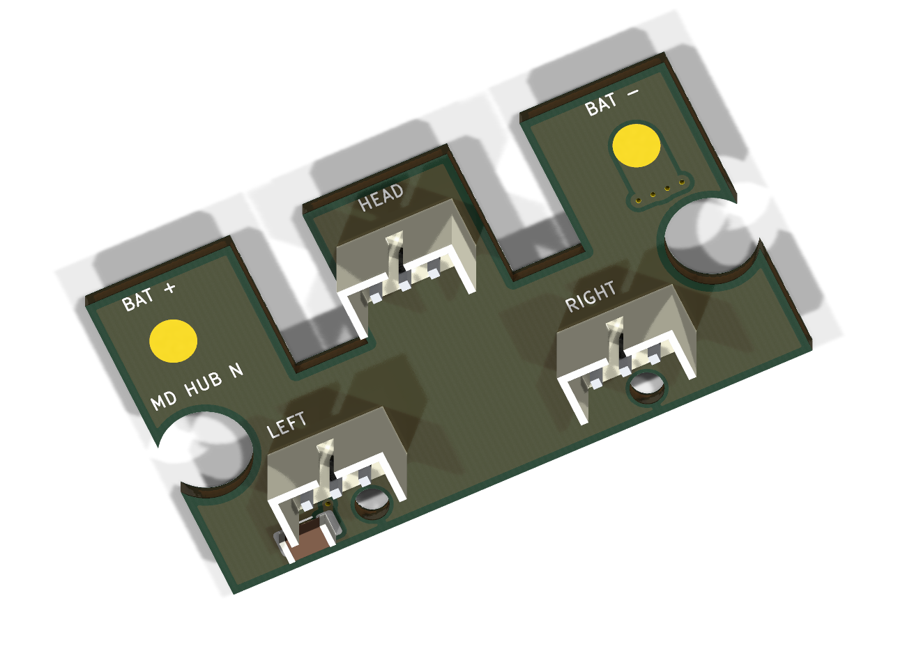

# 舵机电源Hub · Rev N / ECO1

2026-10-20整理到Observer的当前设计归档。**无开关，三路电源并联分配，保留C1去耦电容。** 历史版本和原文件未删除。

## 常用文件

| 用途 | 文件 |
| --- | --- |
| 立创EDA专业版 | [MicroDuck-Hub-RevN-Cap-ECO1.epro](eda/MicroDuck-Hub-RevN-Cap-ECO1.epro) |
| 采购清单 | [BOM.csv](bom/BOM.csv)：2类，共4颗 |
| 源板打样文件 | [Gerber ZIP](manufacturing/MicroDuck-Hub-RevN-Gerber.zip) |
| 可编辑源工程 | [KiCad项目](source/kicad/microduck-power-hub.kicad_pro) |
| 立创同步差异说明 | [ECO1导入说明](docs/ECO1-导入说明.md) |
| 全部资料 | [完整ZIP](../packages/MicroDuck-Hub-RevN-ECO1-Complete.zip) |

## 当前方案

- 三颗CJT A2007WV-3P / C225336：J2接左腿10–14，J3接头部30–34，J4接右腿20–24；Hub座1 GND / 2 VBAT / 3 DATA，DATA共用TTL半双工总线。
- 反向线1→3、2→2、3→1，对应舵机1 DATA / 2 VCC / 3 GND，成品线束尚待万用表通断核对。HAT从舵机链末端供电，无单独HAT座。
- 同一电池左J1正极、右J5负极；正面Ø3mm圆形无孔焊盘。电池接入即供电，断电使用电池插头或外部开关。
- C1=10µF/25V/X7R、1206，跨VBAT/GND，正面位置(6,20.1mm)。它用于局部去耦，不能稳压或保证消除三串同时动作的压降；没有板载开关、稳压、反接或短路保护。
- 每板只买三个AMP座和一颗电容。电池焊盘J1/J5、安装孔H1/H2不需要购买。电容C6119987仅为用户截图中名义规格相符的候选，具体型号可替代，未锁定这个品牌或价格，未下单。

## 板厚和安装

40×22mm，双层FR4，1.6mm，上下成品铜各2oz。Gerber不替代下单时选择板厚/铜厚。安装在10/20舵机输出轴侧上方，保留内侧AMP避让缺口和两侧Ø6凸台开口，中央无穿线孔。

孔位(10.5,20)、(29.5,20)mm，孔距19mm，Ø2.2非金属化；孔距和螺丝仍未实测。用户测得剩余凸台Ø4mm/高2mm。AMP尾脚需修短约0.8mm，焊点总突出≤1.2mm，板底绝缘，并核对板底至最近壳体/金属至少2mm；电池线另固定卸力。

## 验证状态与导入

源KiCad ERC0、DRC0、未连接0，独立13编号焊盘网表合同匹配。原生立创13引脚/13 PAD_NET和铜/走线几何审计通过。ECO1补齐H1/H2无引脚机械符号，原理图/PCB8个位号对应，显式统一BOM与同步属性；物理铜与源Gerber不变。

**立创客户端的新更新预览/DRC、实际孔距/插合/绝缘/带载温升仍待完成，尚无连续9A额定或实物通过结论。** KiCad读取器诊断中恢复其丢失孔/铺铜参数后的未连接0/error0，不是立创客户端DRC0。

将.epro作为新工程导入专业版，检查“导入更新”预览。不要接受删除H1/H2；设计规则、网络规则的同步项保持不勾选，保留PCB的GND专用0.2～3.2mm线宽规则，避免3mm铜颈被默认100mil上限误报。Shift+B重建全部铺铜后再运行DRC，检查未连接和网表差异。

ECO1仅在立创原生工程补充机械符号和元数据；`source/kicad`保存产生当前铜层的源CAD，机械孔仍为PCB机械项。重新转换源CAD不会自动保留ECO1补充，需以本归档立创工程或对应同步处理为准。不要用旧开关版或Rev M不带电容版混合更新。

实测主记录仍在 [07-HAT实测](../../../docs/实测记录/07-HAT实测.md)。本目录的 `validation/` 为设计/格式报告与用户反馈副本，`provenance.json` 和 `manifest.json` 用于追溯来源与校验。

